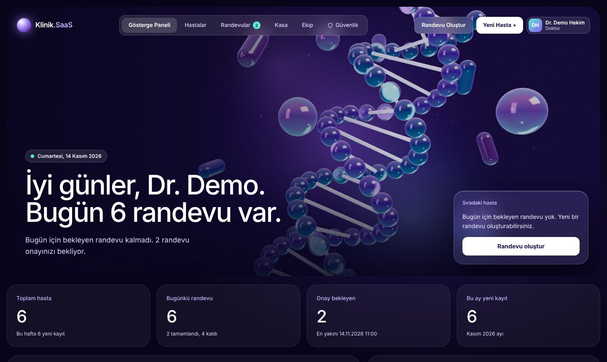
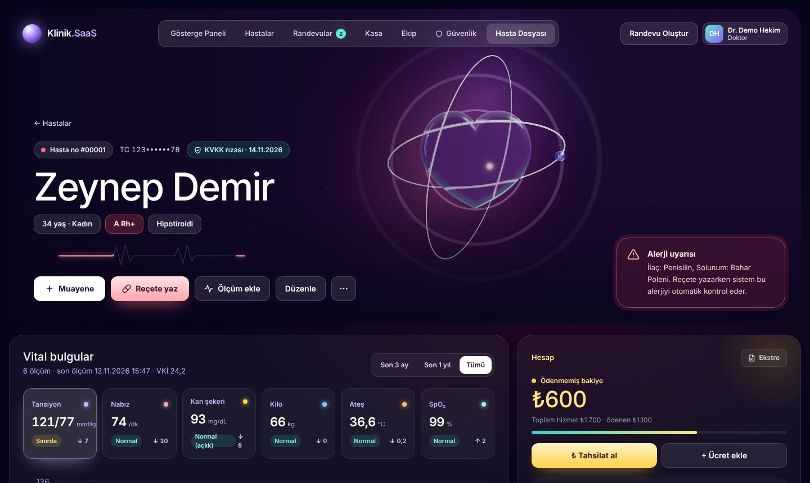
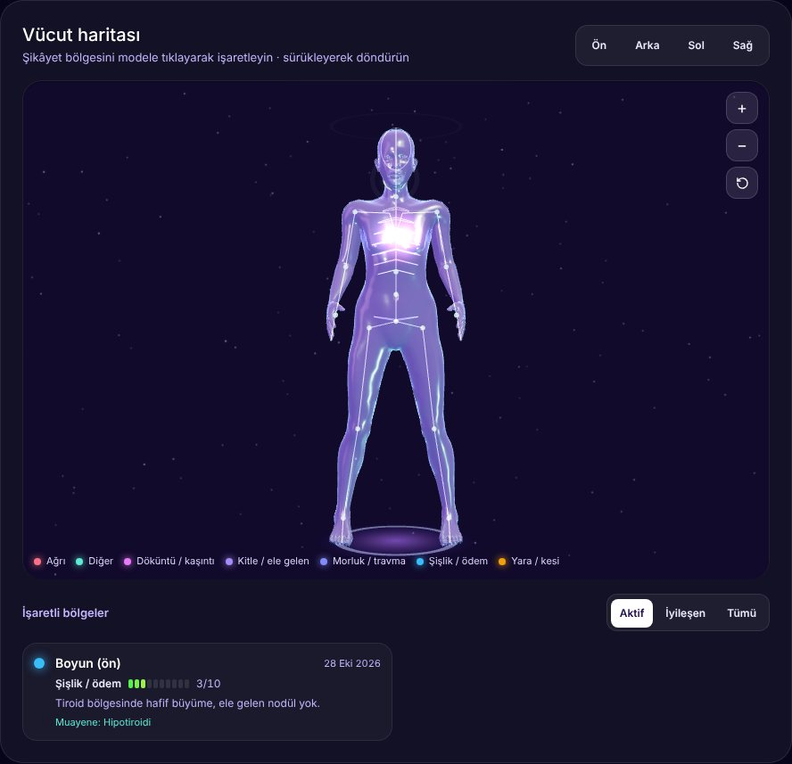
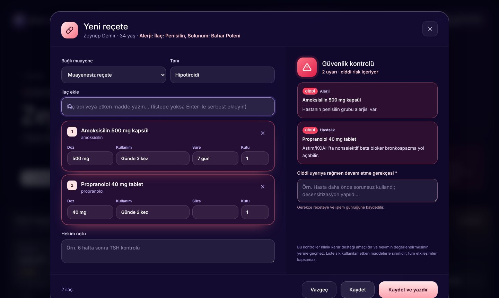
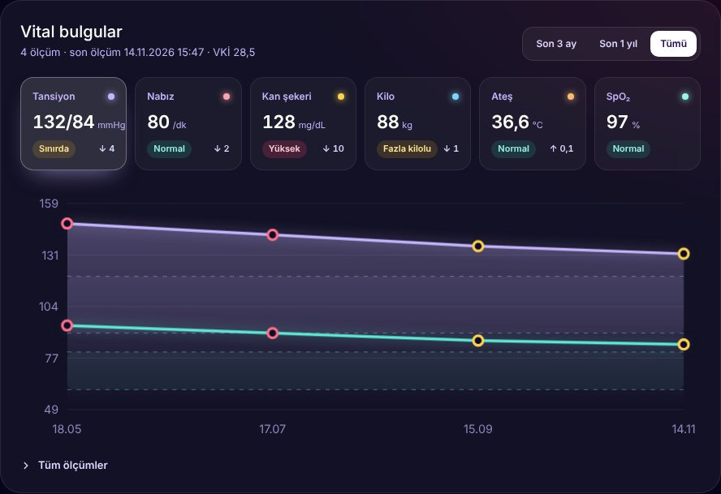
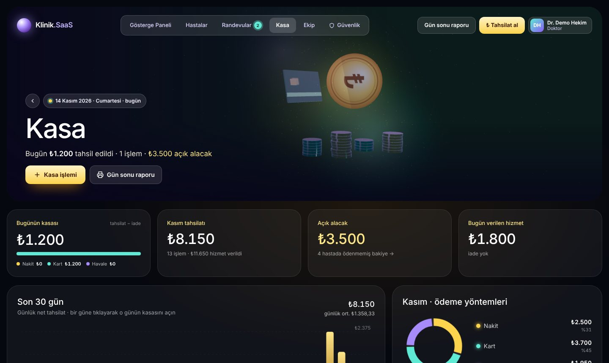
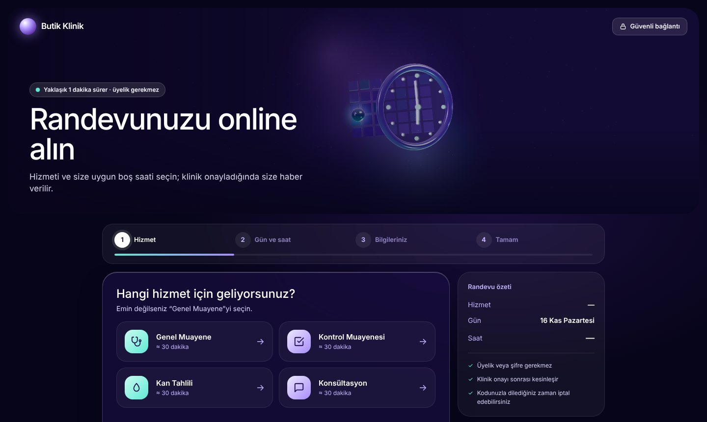
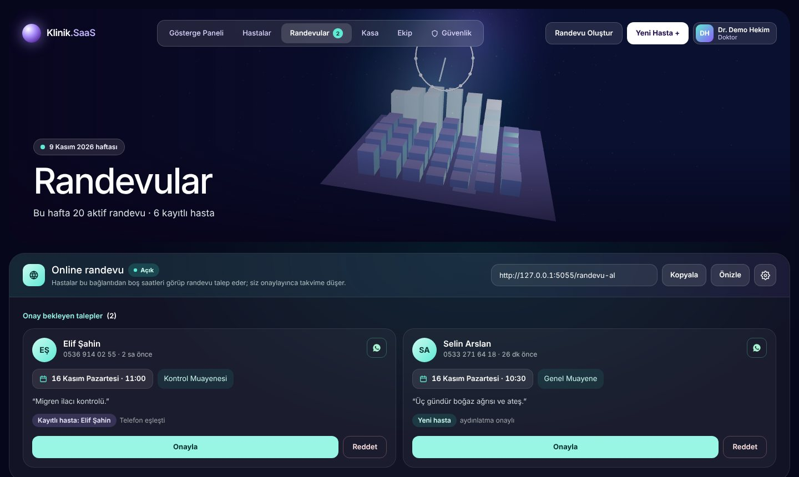
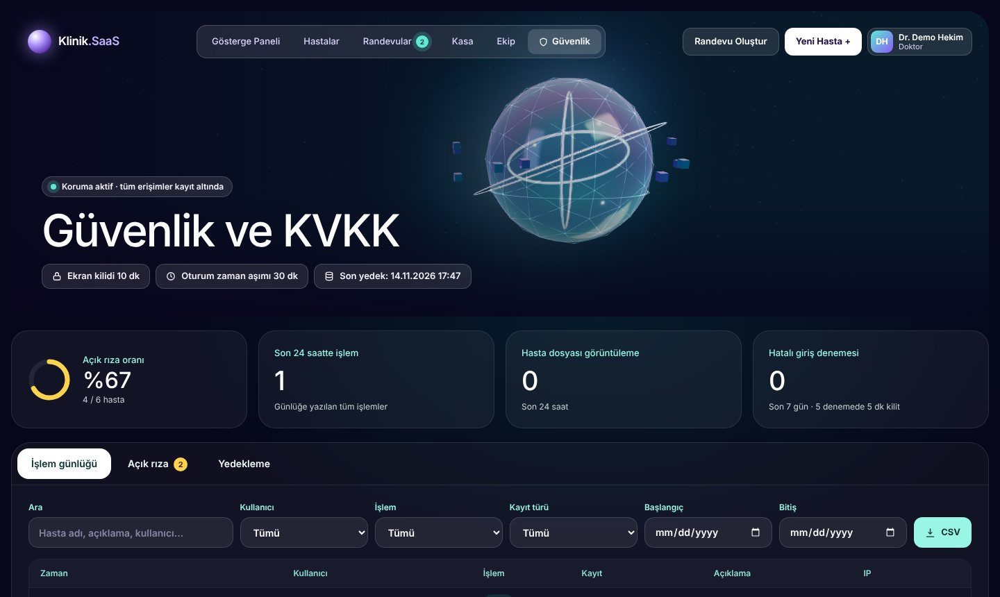
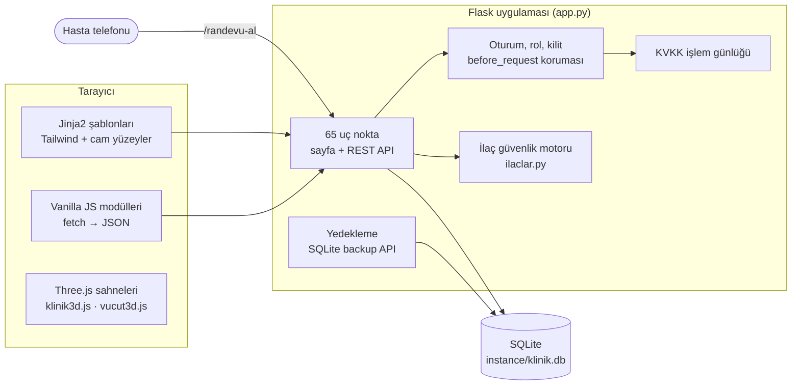

<div align="center">



# 🩺 Klinik.SaaS

### Butik klinikler için sinematik 3D arayüzlü, uçtan uca klinik ve randevu yönetim sistemi

Hasta dosyası · randevu · muayene · **güvenlik kontrollü reçete** · vital grafikler · **3D anatomik vücut haritası** · online randevu · tahsilat ve kasa · KVKK paketi · yedekleme

<br>


**~10.000 satır** · **65 uç nokta** · **13 veri modeli** · **7 farklı 3D sahne** · derleme adımı yok, tek komutla çalışır

</div>

---

## ✨ Neden farklı?

Klinik yazılımları genelde gri tablolar ve kalabalık formlardan oluşur. **Klinik.SaaS** bunun tersini dener: her ekranın arkasında gerçek zamanlı çizilen bir **Three.js sahnesi**, üstünde **koyu cam (glassmorphism)** yüzeyler ve sade, Türkçe bir iş akışı vardır. Görsellik süs değil; hekimin ve sekreterin her gün saatlerce baktığı ekranı **yorucu değil keyifli** hale getirmek için var.

Bunun yanında güzel görünen ama işe yaramayan bir demo değil — **alerji ve ilaç etkileşimi denetimi**, **KVKK işlem günlüğü**, **otomatik yedekleme**, **kasa ve makbuz**, **online randevu** gibi gerçek bir kliniğin ihtiyaç duyduğu parçalar uçtan uca çalışır.

| Ekran | 3D sahne |
|---|---|
| Gösterge paneli | Cam **DNA sarmalı**, yüzen kapsüller |
| Hastalar | Nabız atan **nöral ağ** |
| Hasta dosyası | Atan **cam kalp** ve EKG çizgisi |
| Randevular | Haftanın doluluğuna göre dalgalanan **küp ızgara** |
| Kasa | Dönen **₺ sikke**, cam ödeme kartı, altın kıvılcımlar |
| Güvenlik / KVKK | Faset kesimli çekirdek ve **tarayan kalkan küresi** |
| Online randevu | **Cam saat** ve dalgalanan takvim karoları |

---

## 📸 Ekranlar

<table>
<tr>
<td width="50%"><br><sub><b>Hasta dosyası</b> — atan cam kalp, alerji uyarısı, KVKK durumu</sub></td>
<td width="50%"><br><sub><b>3D anatomik vücut haritası</b> — iskelet, kaburgalar, atan kalp; tıkla ve işaretle</sub></td>
</tr>
<tr>
<td><br><sub><b>Reçete</b> — penisilin alerjisi ve astım + beta bloker uyarısı anında</sub></td>
<td><br><sub><b>Vital bulgular</b> — normal aralık bantlı animasyonlu grafik</sub></td>
</tr>
<tr>
<td><br><sub><b>Kasa</b> — günlük kasa, 30 günlük grafik, alacaklar, tarife</sub></td>
<td><br><sub><b>Online randevu</b> — hastanın girişsiz kullandığı sayfa</sub></td>
</tr>
<tr>
<td><br><sub><b>Randevular</b> — haftalık takvim, online talepler, erteleme</sub></td>
<td><br><sub><b>Güvenlik ve KVKK</b> — işlem günlüğü, açık rıza, yedekler</sub></td>
</tr>
</table>

---

## 🧩 Özellikler

<details open>
<summary><b>👤 Hasta, randevu ve muayene</b></summary>

- Kimlik, iletişim ve tıbbi geçmiş (tanı, kronik hastalıklar, ameliyatlar, alerjiler) ile hasta dosyası; otomatik tamamlamalı hastalık/alerji alanları
- Haftalık takvim, dolu saatlerin kilitlendiği saat ızgarası, durum akışı (Bekliyor → Onaylandı → Tamamlandı / İptal), **erteleme**
- Randevuya bağlı **muayene kaydı**: tanı, bulgular, tedavi planı, kontrol tarihi; muayene sırasında vital girişi
- Rol tabanlı erişim: **Doktor** her şeyi görür; **Sekreter** muayene ve reçete içeriğini göremez
</details>

<details open>
<summary><b>💊 Güvenlik kontrollü reçete</b></summary>

- ~60 yaygın etken madde için akıllı arama, doz ve kullanım şekli önerisi; listede olmayan ilaç serbest eklenebilir
- Her eklemede canlı kontrol: **alerji çapraz reaksiyonu** (ör. penisilin → amoksisilin), **ilaç–ilaç etkileşimi** (ör. varfarin + NSAİİ), **ilaç–hastalık** (ör. astım + propranolol), **mükerrer ilaç**
- “Ciddi” uyarı varken **yazılı gerekçe olmadan kaydedilemez**; gerekçe reçeteye ve günlüğe işlenir
- A5 yazdırılabilir reçete (℞ listesi, alerji kutusu, imza/kaşe alanı)
</details>

<details open>
<summary><b>📈 Vital bulgular</b></summary>

- Tansiyon, nabız, ateş, açlık/tok şeker, SpO₂, kilo/boy ve otomatik **VKİ**
- Girerken anında *normal / sınırda / riskli* ipucu
- Normal aralık bantlı, hover ipuçlu, 3 ay / 1 yıl / tümü aralıklı animasyonlu SVG grafik
</details>

<details open>
<summary><b>🧍 3D anatomik vücut haritası</b></summary>

- Gerçek insan oranlarına sahip, **cam/hologram** görünümlü 3D gövde; içinde parlayan **iskelet, kaburgalar, leğen kemiği**, ~72/dk **çift vuruşla atan kalp** ve **nefes alan akciğerler**
- Üzerine gelince bölge adı (*“Sağ alt karın”, “Sol diz arkası”, “Ense”* …), tıklayınca o noktaya **ağrı / yara / şişlik / döküntü / kitle / morluk** işareti, 0–10 şiddet ve not
- İşaretler muayeneye bağlanır, “iyileşti” olarak kapatılır; listeden seçince model o noktaya döner ve yakınlaşır
- Sürükle-döndür, tekerlek/iki parmakla yakınlaştır, Ön/Arka/Sol/Sağ görünümler
</details>

<details open>
<summary><b>🌐 Online randevu</b></summary>

- Hastanın **üyeliksiz** kullandığı mobil uyumlu sayfa: hizmet → gün & saat → bilgiler → onay
- Randevu kodu ile **takip, iptal ve takvime ekleme (.ics)**
- Klinik tarafında onay bekleyen talepler; TC/telefon ile **mevcut hastayla otomatik eşleştirme**, farklı saat önerme, **tek tıkla WhatsApp bildirimi**
- Ayarlar: açık/kapalı, hizmetler, kapalı günler, kaç gün ileri, en erken kaç saat sonrası, fiyat gösterimi
- Kötüye kullanıma karşı bal küpü alanı ve IP / telefon sınırlaması
</details>

<details open>
<summary><b>💰 Tahsilat ve kasa</b></summary>

- Hizmet **ücret tarifesi**; randevu tamamlanınca ücret hastanın hesabına **otomatik** eklenir
- Tahsilat (Nakit / Kart / Havale), hizmet ücreti, indirim, iade; “işlem sonrası bakiye” önizlemesi
- **Kayıtlar silinmez**, gerekçeyle iptal edilir (üstü çizili kalır)
- Günlük kasa, aylık özet, son 30 gün grafiği, ödeme yöntemi halkası, **alacaklar listesi** ve WhatsApp hatırlatma
- Yazdırılabilir **makbuz** (tutar yazıyla), **hesap ekstresi**, **gün sonu raporu**, muhasebe için **CSV**
</details>

<details open>
<summary><b>🛡️ KVKK ve güvenlik</b></summary>

- **Açık rıza** kaydı, yazdırılabilir aydınlatma metni, rızanın geri çekilmesi, hasta verisinin **makinece okunabilir dışa aktarımı** (KVKK m.11)
- **İşlem günlüğü**: kim, ne zaman, hangi kaydı görüntüledi / değiştirdi / yazdırdı — filtre ve CSV
- **Ekran kilidi** (10 dk hareketsizlik), **oturum zaman aşımı** (30 dk), **kaba kuvvet kilidi** (5 hatalı giriş → 5 dk)
- Şifreler `werkzeug` ile hash'lenir, oturum çerezleri `HttpOnly` + `SameSite=Lax`, açık yönlendirme koruması
- **Yedekleme**: günlük otomatik yedek (son 14 saklanır), elle yedek, indirme, bütünlük kontrolünden geçen **geri yükleme**
</details>

---

## 🛠️ Nasıl yaptık?

### Mimari



### Teknik kararlar

| Konu | Yaklaşım |
|---|---|
| **Derleme adımı yok** | Tailwind ve Three.js CDN'den; JS saf (vanilla) ve modüler. `python app.py` yeterli. |
| **Veritabanı göçü** | `semayi_guncelle()` açılışta eksik tabloları oluşturur, eksik sütunları `ALTER TABLE` ile ekler — yeni özelliklerde veritabanını silmek gerekmez. |
| **Sinematik 3D** | `MeshPhysicalMaterial` ile iletim (transmission), yanardönerlik (iridescence) ve PMREM ortam yansıması; ACES tonlama. Sahne ekranda değilken `IntersectionObserver` ile çizim durur, `prefers-reduced-motion` desteklenir. |
| **Anatomik model** | CC0 lisanslı **MakeHuman** temel modeli Python/NumPy ile işlendi: kollar A-pozundan doğal duruşa yumuşak ağırlıklarla indirildi, eklem derinlikleri gövde kesitinden hesaplandı, konum `Int16` / normal `Int8` olarak **280 KB'lık** ikili dosyaya sıkıştırıldı. Tarayıcı bunu `DataView` ile çözer. |
| **Bölge adlandırma** | Tıklanan nokta, iskelet segmentlerine olan *yarıçapa göre normalize* uzaklıkla sınıflandırılır; yüzey normali ön/arka ve yan bilgisini verir. Eski işaretler model değişse de kendi bölgesindeki en yakın yüzeye oturtulur. |
| **Hologram görünüm** | Gövdenin üstüne Fresnel kenar parlaması yapan küçük bir GLSL shader; iç anatomi `depthTest: false` ile cam derinin içinden görünür. |
| **İlaç güvenliği** | Kural tabanlı motor: alerji grupları, etkileşim çiftleri ve hastalık uyarıları; Türkçe karakterden bağımsız normalizasyon, ciddiyete göre sıralama. |
| **Para** | Tüm tutarlar **kuruş cinsinden tam sayı**; yuvarlama hatası yok. Makbuzda tutar Türkçe yazıyla. |
| **Denetlenebilirlik** | Kritik her işlem `IslemKaydi` tablosuna; kasa kayıtları silinmez, gerekçeyle iptal edilir. |

### Kullanılan teknolojiler

**Sunucu:** Python 3 · Flask 3 · Flask-SQLAlchemy · SQLite · Werkzeug (şifre hash'leme)
**Arayüz:** Jinja2 · Tailwind CSS · Vanilla JavaScript · SVG grafikler · Inter & Sora yazı tipleri
**3D:** Three.js r149 · özel GLSL Fresnel shader · MakeHuman (CC0) gövde modeli
**Geliştirme:** Playwright ile tarayıcıda uçtan uca test ve ekran görüntüsü

---

## 🚀 Kurulum

```bash
git clone https://github.com/egemenulutas123-wq/butik-klinik-saas.git
cd butik-klinik-saas
python -m venv venv
```

```bash
# Windows (PowerShell)
.\venv\Scripts\python.exe -m pip install -r requirements.txt
.\venv\Scripts\python.exe -m flask --app app ornek-veri   # isteğe bağlı: demo veriler
.\venv\Scripts\python.exe app.py

# macOS / Linux
venv/bin/pip install -r requirements.txt
venv/bin/flask --app app ornek-veri
venv/bin/python app.py
```

Tarayıcıda **http://127.0.0.1:5000** adresini açın.

| Demo hesabı | E-posta | Şifre |
|---|---|---|
| Doktor | `doktor@klinik.local` | `klinik123` |
| Sekreter | `sekreter@klinik.local` | `klinik123` |

> Demo verisi yüklemezseniz ilk açılışta **kurulum ekranı** gelir ve ilk doktor hesabını siz oluşturursunuz.

**İpuçları**

- Klinik adını değiştirmek için: `KLINIK_ADI="Şifa Kliniği"` ortam değişkeni
- Online randevu sayfasını aynı ağdaki telefonlardan açmak için `app.py` sonunda `app.run(host="0.0.0.0")`
- Canlı ortamda `debug=True` kapatılmalı, HTTPS arkasında çalıştırılmalı ve `KLINIK_GIZLI_ANAHTAR` tanımlanmalıdır

---

## 📁 Proje yapısı

```
butik-klinik-saas/
├── app.py                 # Flask uygulaması: sayfalar, REST API, güvenlik, yedekleme, kasa, online randevu
├── models.py              # SQLAlchemy modelleri (13 tablo)
├── ilaclar.py             # İlaç listesi ve alerji / etkileşim / hastalık kuralları
├── requirements.txt
├── static/
│   ├── css/klinik.css     # Cam yüzeyler, animasyonlar
│   ├── js/
│   │   ├── klinik3d.js    # 7 sinematik 3D sahne
│   │   ├── vucut3d.js     # Anatomik vücut haritası
│   │   ├── klinik.js      # Ortak: bildirim, modal, ekran kilidi
│   │   ├── profil.js      # Hasta dosyası: vital grafik, muayene, reçete oluşturucu
│   │   ├── kasa.js / hesap.js / online_talepler.js
│   └── models/insan.bin   # Sıkıştırılmış 3D insan modeli (MakeHuman, CC0)
├── templates/             # Jinja2 sayfaları + yazdırılabilir belgeler (reçete, makbuz, ekstre…)
└── docs/ekran/            # README ekran görüntüleri
```

---

## 🗺️ Yol haritası

- [ ] Randevu hatırlatmaları ve “gelmedi” takibi
- [ ] Raporlar paneli (gelir, tanı dağılımı, yoğunluk ısı haritası) + PDF
- [ ] Tahlil / görüntü dosyası yükleme ve laboratuvar değer grafikleri
- [ ] `Ctrl+K` komut paleti
- [ ] Bekleme salonu ekranı
- [ ] Sesli muayene notu (Web Speech API)
- [ ] Çoklu hekim çalışma takvimi
- [ ] PWA — telefona uygulama olarak kurulum

Fikirleriniz için [Issues](../../issues) sekmesini kullanabilirsiniz.

---

## ⚠️ Önemli not

Bu proje **eğitim ve portföy amaçlı** geliştirilmiştir; onaylı bir tıbbi cihaz veya hastane bilgi yönetim sistemi değildir.

- İlaç güvenlik kontrolleri **sınırlı bir kural listesine** dayanır, tüm etkileşimleri kapsamaz ve **hekimin değerlendirmesinin yerine geçmez**.
- KVKK aydınlatma metni bir **şablondur**; gerçek kullanımdan önce hukuk danışmanına kontrol ettirilmelidir.
- Makbuzlar bilgi amaçlıdır; **fatura / e-Arşiv belgesi yerine geçmez**.
- Depoda gerçek hasta verisi yoktur; tüm demo kayıtlar kurgusaldır. `instance/` klasörü (veritabanı, gizli anahtar, yedekler) `.gitignore` ile dışarıda tutulur.

---

## 🤝 Katkı

1. Depoyu fork'layın
2. Özellik dalı açın: `git checkout -b ozellik/harika-fikir`
3. Değişikliklerinizi gönderin ve Pull Request açın

Arayüz metinleri Türkçedir; yeni metinlerin de Türkçe olmasına özen gösterin.

---

## 📄 Lisans

**MIT** — ayrıntılar için [LICENSE](LICENSE). Üçüncü taraf bileşenler ve lisansları için [THIRD_PARTY_NOTICES.md](THIRD_PARTY_NOTICES.md).

<div align="center">
<br>
<b>Melid Forge</b> tarafından ❤️ ile geliştirildi · <a href="https://github.com/egemenulutas123-wq">@egemenulutas123-wq</a>
</div>
